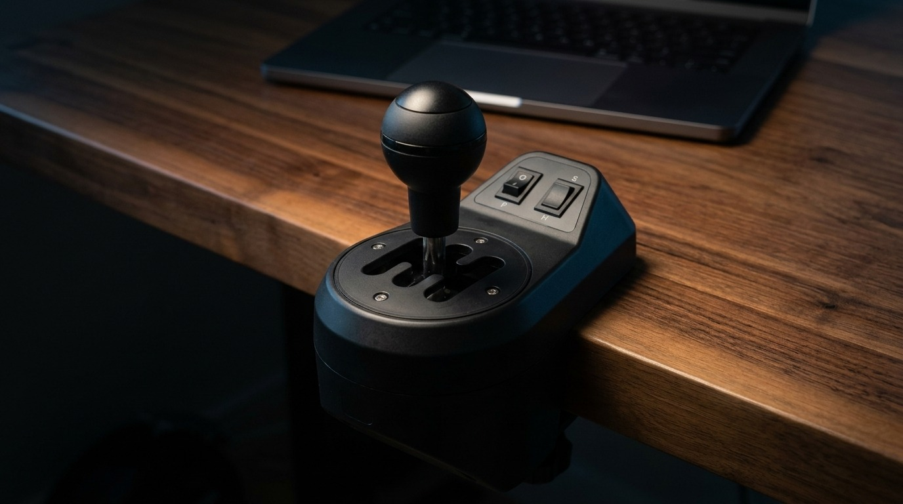
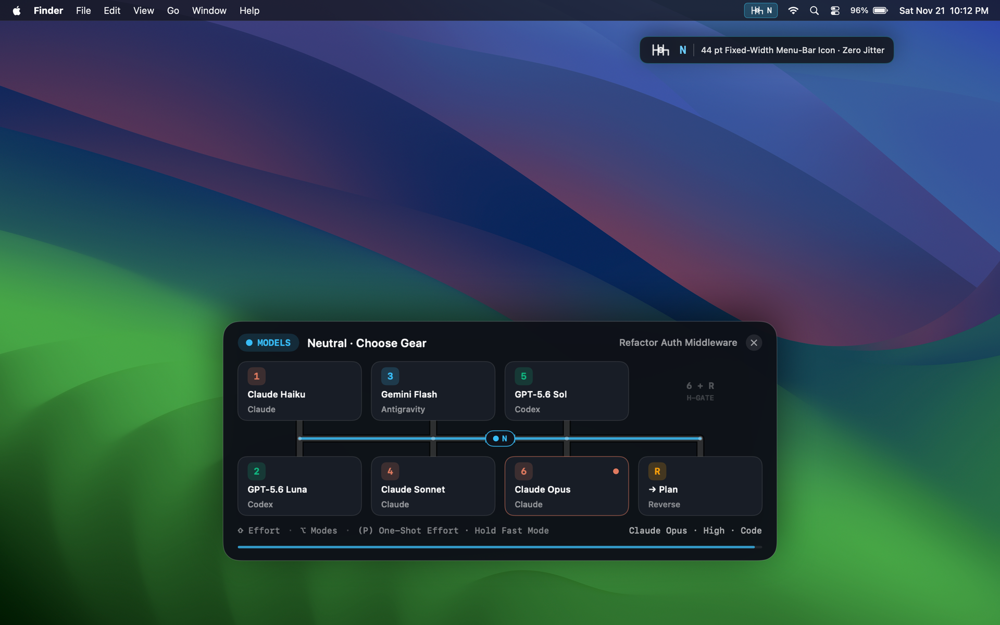
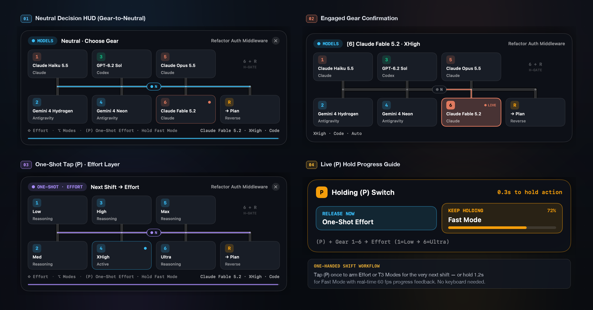
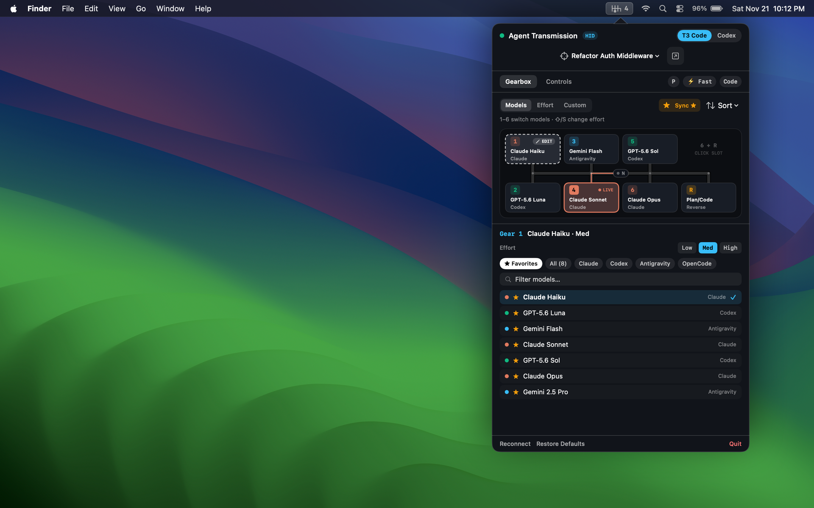
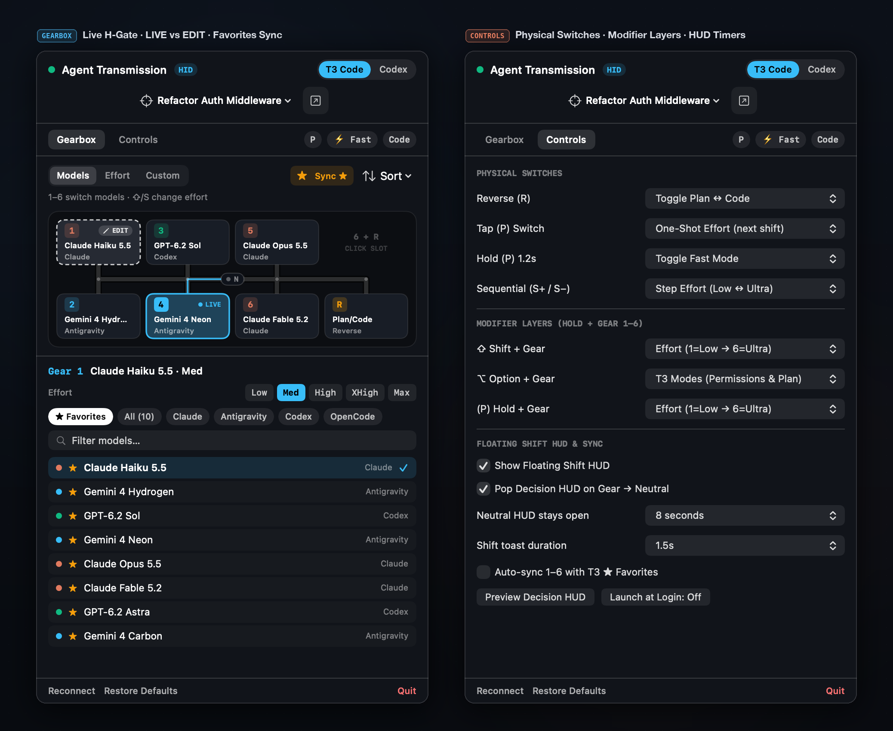

<h1 align="center">Agent Transmission</h1>

<p align="center">
  <strong>Shift coding-agent models, reasoning effort, and agent modes with a real $40 USB H-pattern gearshifter on macOS.</strong>
</p>

<p align="center">
  
  
  
  <a href="LICENSE"></a>
</p>

---

<p align="center">
  
  <br />
  <sub><em>The $40 NiTHO GS-SH USB H-pattern shifter clamped to my desk. Full disclosure: studio-lit AI re-shoot of my actual shifter because I wasn't going to tidy my desk for a product shot — <a href="#real-hardware-demo">unvarnished real hardware video right below</a>.</em></sub>
</p>

---

## Why a USB Gearshifter?

I saw someone float the concept of shifting coding-agent models and reasoning effort with a physical manual gearshifter on X, and **I HAD to build it — so I did.**

Switching models and reasoning levels through nested dropdowns always broke my flow. You're deep in a diff, you know you want a fast Haiku/Flash pass or a full-send Opus/Ultra reasoning run, and suddenly you're hunting tiny menus with a cursor. Meanwhile, a **$40 6-speed + Reverse sim-racing USB shifter** with a mechanical H-gate, sequential mode switch, and physical `(P)` rocker exists.

I ordered a NiTHO `GS-SH Gearshifter`, wired it straight into macOS IOKit USB HID, and built **Agent Transmission** — a zero-dependency native Swift menu-bar app that talks directly to **T3 Code** (over native Orchestration V2 WebSocket RPC across Claude, Codex, Antigravity, and OpenCode) and **Codex Desktop** (over local Unix IPC).

> **Interactive web simulator & write-up:** [charlesbine.com/projects/agent-transmission](https://charlesbine.com/projects/agent-transmission/)

---

## Floating Shift HUD

The HUD stays completely out of your way while you code, then wakes up the instant your hand touches the shifter — non-activating, zero focus stealing, and click-through-friendly with a clickable `×` dismiss button:

<p align="center">
  
</p>

<p align="center">
  
</p>

- **01 · Neutral Decision HUD (Gear → Neutral):** Pull the lever out of gear into Neutral and the full 6+R H-gate map floats into view with the Neutral spine lit, your current active model highlighted, a draining countdown bar (configurable `4s`, `8s`, `15s`, or `Until back in gear`), and a live modifier legend.
- **02 · Engaged Gear Confirmation:** Slot cleanly into gears `1–6` or `R` (25 ms settle debounce) and the matching channel lights up from `N` to the engaged gear with a **`● LIVE`** badge and friendly confirmation toast.
- **03 · One-Shot Tap `(P)` Effort / Modes Layer:** Holding a modifier while shifting takes two hands — so tapping `(P)` once arms **Effort (`1=Low → 6=Ultra`)** or **T3 Modes** for your *very next shift* with a purple draining countdown bar, then automatically returns to Models.
- **04 · Live `(P)` Hold Progress Guide:** Holding `(P)` opens a live 60 fps guide showing what happens if you **Release Now** (e.g., One-Shot Effort or Parking Brake) versus **Keep Holding** (`1.2s` fill bar to toggle Fast Mode) plus the `(P) + Gear` chord hint.
- **Live Keyboard Modifier Morphing:** Hold `⇧ Shift` or `⌥ Option` while the HUD is open and the H-gate morphs live between **Models**, **Effort**, and **T3 Modes (`Ask` / `Edits` / `Auto` / `Full` / `Plan` / `Code`)** — pausing the auto-hide timer while you decide.

---

## Menu-Bar Popover & Live H-Gate

Clicking the fixed-width H-gate icon in your macOS menu bar opens a persistent dark SwiftUI popover that stays open while you map gears, inspect live state, or switch targets — with zero menu-bar jitter as you shift:

<p align="center">
  
</p>

<p align="center">
  
</p>

- **Distinct `● LIVE` vs `✎ EDIT` states:** Your physical gear lights up with provider-colored glow, solid border, and an illuminated `N → Gear` rail (`● LIVE`); the slot you're configuring in the popover gets a crisp white dashed outline (`✎ EDIT`).
- **Three Gearbox Modes:**
  - **Models** — Gears `1–6` switch models across any connected provider; `⇧` / `S+` / `S−` adjust effort.
  - **Effort** — Gears `1–6` snap straight to `Low`, `Med`, `High`, `XHigh`, `Max`, `Ultra` on the active model.
  - **Custom** — Every gear stores an exact `(model + effort)` preset for one-throw combos.
- **`★ Sync` & Smart Sorting:** Pull your T3 Code `★ Favorites` straight onto gears `1–6` in one click (or enable auto-sync), and sort them **Fast → Smart** or **Smart → Fast** by model tier.
- **Full Switch & Modifier Customization:** Remap **Reverse (`R`)** (`Toggle Plan ↔ Code`, `Interrupt Active Run`, `Settle / Complete Thread`, `Review preset`, or disabled), **Tap `(P)`** (`One-Shot Effort`, `One-Shot T3 Modes`, `Software Parking Brake`, `Toggle Plan ↔ Code`, `Interrupt`), **Hold `(P)` (`1.2s`)** (`Toggle Fast Mode`, `Interrupt`, `Parking Brake`), **Sequential (`S+ / S−`)**, and **`⇧ Shift` / `⌥ Option` / `(P)` Hold + Gear** layers.
- **Friendly Error Toasts:** If a shift can't apply (e.g., trying to switch providers mid-turn while a thread is actively running), the HUD unwraps the RPC error into a plain-English toast (*"Thread Is Busy"*) instead of dumping raw JSON.

---

## Real Hardware Demo

https://github.com/user-attachments/assets/9548d44b-e48f-4e01-b5ed-2294c923b9d5

Left: real stabilized phone footage (with mechanical shifter audio) of the physical NiTHO GS-SH H-pattern shifter clamped to my desk. Right: the updated [Agent Transmission 2.0 MP4](docs/assets/agent-transmission-demo.mp4) pairs those exact physical throws with the real SwiftUI Floating Shift HUD, live `H-gate` menu-bar indicator, and Orchestration V2 WS RPC dispatches.

---

## Requirements

- **macOS 13 or later** on Apple silicon
- **NiTHO GS-SH Gearshifter** (USB VID `0x2345`, PID `0xe00c`)
- **T3 Code** (local server + `t3` CLI) and/or **Codex Desktop** / Codex CLI installed locally
- Your own model provider access configured in T3 Code or Codex

Agent Transmission is an independent open-source project. It is not affiliated with or endorsed by OpenAI or NiTHO. It ships with zero telemetry and never sends prompts, code, or session contents anywhere.

---

## Install

Download the release ZIP, drag **Agent Transmission.app** to `/Applications`, launch it, and plug in the shifter. The app runs purely in the menu bar (no Dock icon) with a fixed-width live H-gate indicator.

- Switch between **T3 Code** and **Codex Desktop** live from the top-right segmented toggle in the popover (persisted in `UserDefaults`). On first launch, it defaults to **T3 Code** when `~/.t3/userdata/server-runtime.json` is present, and **Codex Desktop** otherwise.
- Enable **Launch at Login** in the **Controls** tab to start automatically when you sign in.
- Ad-hoc signed local builds may require right-click → **Open** on first launch. Maintainers can build Developer-ID-signed and notarized releases with the scripts below.

---

## Targets

### T3 Code (Native WebSocket RPC)

`T3CodeAgentTarget` connects directly to your local T3 Code server over its native Orchestration V2 WebSocket RPC protocol with zero third-party Swift dependencies (`Foundation` + `URLSessionWebSocketTask`):

- **Zero-config discovery:** Reads `$T3CODE_HOME/userdata/server-runtime.json` (default `~/.t3/userdata/server-runtime.json`) for the live server origin and port.
- **Scoped auth:** Stores a bearer session in `~/.config/agent-transmission/session.json` (`0600`). When missing or expired (`401`/`403`), it invokes `$T3CODE_CLI_PATH` (default `~/.t3/bin/t3`) to mint a scoped token:

  ```sh
  t3 auth session issue \
    --scope orchestration:read \
    --scope orchestration:operate \
    --label "Agent Transmission" \
    --ttl 365d \
    --json
  ```

  and exchanges it at `POST /api/auth/websocket-ticket` for a short-lived WebSocket ticket.
- **Live catalog & thread sync:** Subscribes to `subscribeServerConfig` and `orchestration.subscribeShell` to discover connected providers, `★ Favorites`, per-model option descriptors (`effort`, `reasoningEffort`, `thought_level`, `fastMode`, `serviceTier`), interaction mode (`Plan` / `Code`), and runtime permission mode (`Ask` / `Edits` / `Auto` / `Full`).
- **Focused thread tracking & deep links:** Follows the active thread automatically (or pin any thread from the popover header) and opens it directly via `t3code://threads/<environmentId>/<threadId>`.

### Codex Desktop (Experimental Local IPC)

Task discovery uses the documented local Codex app-server protocol via the installed Codex CLI. Focused-task detection and settings writes talk directly to Codex Desktop's versioned, user-owned local Unix IPC router at `~/.codex/ipc/ipc.sock`, because the app-server API does not yet expose a stable way to mutate an already-open Desktop-owned task.

| Position | Default Codex Preset | Model | Effort |
| --- | --- | --- | --- |
| 1 | Luna Max | `gpt-5.6-luna` | `max` |
| 2 | Sol Medium | `gpt-5.6-sol` | `medium` |
| 3 | Sol High | `gpt-5.6-sol` | `high` |
| 4 | Sol XHigh | `gpt-5.6-sol` | `xhigh` |
| 5 | Sol Max | `gpt-5.6-sol` | `max` |
| 6 | Sol Ultra | `gpt-5.6-sol` | `ultra` |
| R | Review | `gpt-5.6-sol` | `max` |

Every slot is customizable per target and persisted independently. Because the Codex Desktop IPC boundary is experimental, Agent Transmission never falls back to Accessibility/UI scripting — it fails closed with a clear status message and automatically reconnects with bounded backoff when T3 Code or Codex restarts. Settings apply to subsequent turns and never replay silently on Neutral, focus change, remapping, or parking-brake release.

---

## Adapter Architecture

The Swift core (`AgentTransmissionCore`) has zero dependency on NiTHO, IOKit, T3 Code, or Codex. Hardware controllers and coding agents meet strictly through two public protocols in [`Sources/AgentTransmissionCore/IntegrationContracts.swift`](Sources/AgentTransmissionCore/IntegrationContracts.swift):

```text
ControlSurface → ControlSurfaceEvent → AppModel → AgentSettingsUpdate → AgentTarget
     NiTHO                                                      T3 Code | Codex Desktop
```

- **`ControlSurface` (`NiTHOControlSurface`):** Owns USB HID discovery (`0x2345:0xe00c`), raw button reports, and `ShifterStateMachine` (25 ms gear settle debounce, 100 ms neutral settle for the Decision HUD, hold consumption). Emits semantic events and never imports an agent target.
- **`AppModel`:** Owns gearbox modes (`Models` / `Effort` / `Custom`), modifier & one-shot layers, per-target mappings, parking-brake lockout, live HUD state, and runtime target switching.
- **`AgentTarget` (`T3CodeAgentTarget`, `CodexAgentTarget`):** Owns thread discovery, focus tracking, live catalog & option descriptors, deep-link URLs, and settings/mode writes — never knowing what hardware produced the shift.

Want to wire a different USB sim shifter, MIDI controller, or another coding agent? You only need to implement one side of the contract.

---

## Hardware Notes (NiTHO GS-SH)

- **Buttons 1–6:** Forward H-pattern gears (`1`–`6`)
- **Button 7:** Reverse (`R`)
- **Buttons 8–9:** Sequential mode throws (`S+` / `S−`)
- **Button 10:** Momentary `(P)` rocker switch
- **Neutral:** Electrically open (no buttons pressed); `ShifterStateMachine` waits 100 ms in Neutral after leaving a gear before triggering the Decision HUD so fast cross-gate throws (`2 → 3`, `4 → 5`) never flash Neutral mid-shift.

---

## Build, Test & Package

```sh
swift test
swift run AgentTransmission
```

Build an ad-hoc-signed `.app` bundle and versioned release ZIP:

```sh
./scripts/package-app.sh
```

Build a Developer-ID-signed and notarized release:

```sh
AGENT_TRANSMISSION_SIGN_IDENTITY="Developer ID Application: Your Name (TEAMID)" \
  ./scripts/package-app.sh

AGENT_TRANSMISSION_NOTARY_PROFILE="agent-transmission" \
  ./scripts/notarize-app.sh
```

---

## License

Copyright 2026 Meta Ember. Licensed under the [Apache License 2.0](LICENSE).

Apache-2.0 permits commercial redistribution, including selling compiled copies, as long as its terms are followed. It does not grant rights to project or third-party trademarks.
